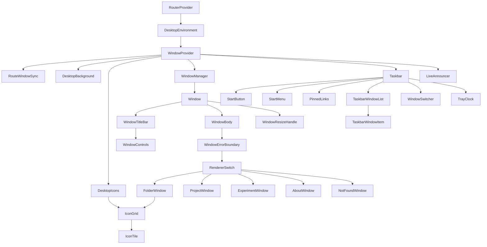
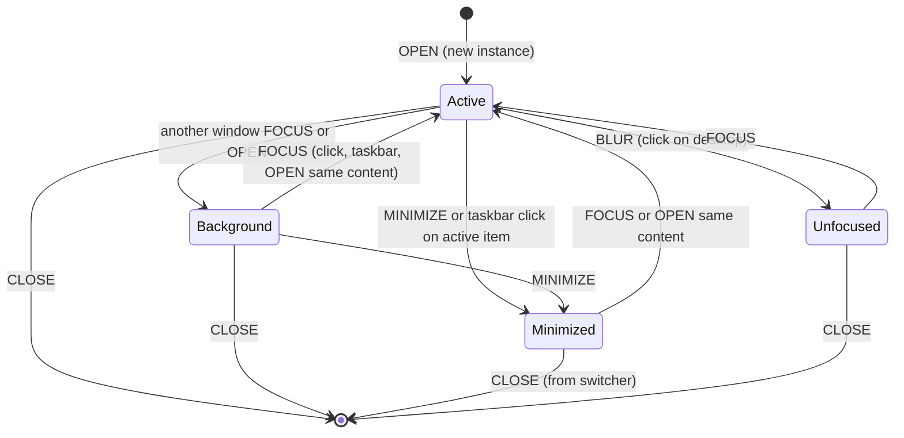
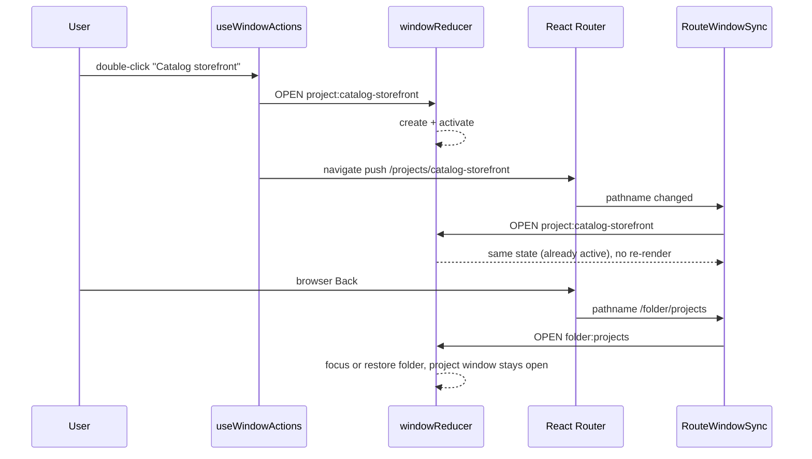

# Portfolio OS — Design System Specification

This document is the source of truth for the visual language, component architecture, window manager, routing, content model, and interaction rules of the portfolio. It is written so that a developer or a coding agent can implement the application without inventing fundamental rules. When this document makes a decision, it records the rationale; implementation should follow the decision rather than reopen it.

**Installed stack (do not assume other major versions):**

| Package | Version | Notes that constrain this spec |
| --- | --- | --- |
| `react`, `react-dom` | 19.2 | `useReducer`, Context, `lazy`, `Suspense`, `inert` as a boolean prop. |
| `react-router` | 7.18 | Data mode via `createBrowserRouter`; import from `react-router`, not `react-router-dom`. |
| `tailwindcss` + `@tailwindcss/vite` | 4.3 | CSS-first configuration. There is no `tailwind.config.js`. Tokens live in `@theme` inside `src/styles/index.css`. |
| `motion` | 14.3 | Import from `motion/react`. |
| `lucide-react` | 1.57 | **Contains no brand icons.** GitHub, LinkedIn and Instagram marks must be local SVG components. |
| `typescript` | 6.0 | Strict typing; discriminated unions for content and actions. |

No other runtime dependency is required by this specification. Do not add Redux, Zustand, `clsx`, `tailwind-merge`, a drag library, or a UI kit.

---

## Table of contents

1. [Product vision and design principles](#1-product-vision-and-design-principles)
2. [Visual identity and design tokens](#2-visual-identity-and-design-tokens)
3. [Component hierarchy and responsibilities](#3-component-hierarchy-and-responsibilities)
4. [Window manager state model](#4-window-manager-state-model)
5. [Routing and URL synchronization](#5-routing-and-url-synchronization)
6. [Content data model](#6-content-data-model)
7. [Window sizing, positioning and layering](#7-window-sizing-positioning-and-layering)
8. [Responsive behavior](#8-responsive-behavior)
9. [Accessibility standards](#9-accessibility-standards)
10. [Motion and interaction specifications](#10-motion-and-interaction-specifications)
11. [Tailwind CSS conventions](#11-tailwind-css-conventions)
12. [Implementation guidelines and architectural decisions](#12-implementation-guidelines-and-architectural-decisions)

---

## 1. Product vision and design principles

### 1.1 Vision

The portfolio is a small, personal operating system that runs in the browser. Visitors arrive at a desktop, open folders, and launch documents that describe the owner's work: who they are (About Me), what they have shipped for clients and for themselves (Projects), and what they are tinkering with (Experiments).

The working name of the visual identity is **Warm Workstation**. It borrows the *interaction grammar* of Windows 7 (desktop icons, a bottom taskbar, a Start menu, title bars with minimize/maximize/close, windows that stack) and pairs it with the *material* of the current site: warm paper, deep ink, and a rust accent. The desktop is dark and calm; windows are light, paper-like documents sitting on it. The result should feel like a well-kept personal machine, not a skin of someone else's OS.

### 1.2 Design principles

| # | Principle | What it means in practice |
| --- | --- | --- |
| 1 | **Familiar grammar, original material.** | Every interaction a Windows user expects (double-click to open, click taskbar to restore, title bar to drag) works as expected. No Aero glass gradients, no Windows logos, no copied icons or sounds. |
| 2 | **Content first, chrome second.** | Chrome is thin, quiet and consistent. Window bodies use real document typography. Decoration never competes with project content. |
| 3 | **Nothing is lost.** | Opening a window never closes another. Minimizing never destroys state. Only an explicit close removes a window. |
| 4 | **The URL tells the truth.** | The address bar always points at the content in the foreground window, so links can be shared and refreshed. |
| 5 | **Rewards for the curious, not toll booths for everyone.** | Developer details (monospaced paths, file extensions, item counts, a tray clock) are present but small. There is no fake boot screen, no artificial loading delay, no animation that blocks input. |

### 1.3 Explicit non-goals

- A literal Windows 7 clone or any use of Microsoft trademarks, wallpapers, icon art or sounds.
- A right-click context menu. The browser context menu stays intact in v1.
- Multiple desktops, file system writes, drag-and-drop of icons, or icon rearrangement.
- Persisting window layout across page reloads (see §12, ADR-08).

---

## 2. Visual identity and design tokens

All tokens are declared in `src/styles/index.css` inside `@theme`, which makes Tailwind generate utilities for them (`bg-window`, `text-fg-muted`, `rounded-window`, `shadow-window-active`, `font-mono`, `text-label`, `ease-os-out`, ...). Components consume **semantic** tokens only. Raw palette tokens exist so that semantic tokens have a single place to point to.

### 2.1 Raw palette

The ink, paper and rust ramps extend the existing tokens (`--color-ink #1c1915`, `--color-muted #4f493f`, `--color-paper #f3efe7`, `--color-sand #e6dfd2`, `--color-line #ddd4c4`, `--color-accent #8d3d1b`), which keep their exact values in the new ramps.

| Token | Hex | Role |
| --- | --- | --- |
| `--color-ink-950` | `#14110e` | Desktop base |
| `--color-ink-900` | `#1c1915` | Primary text on light; taskbar base (existing `ink`) |
| `--color-ink-800` | `#2a251f` | Raised dark surfaces (Start menu panels) |
| `--color-ink-700` | `#3a342c` | Dark borders, dark hover |
| `--color-ink-600` | `#4f493f` | Muted text on light (existing `muted`) |
| `--color-ink-500` | `#6b6357` | Subtle text on light, inactive title text |
| `--color-ink-400` | `#8a8174` | Decorative only (icons, dividers). **Never text on light.** |
| `--color-ink-300` | `#b5ab9c` | Muted text on dark |
| `--color-paper-50` | `#fbf8f2` | Window body |
| `--color-paper-100` | `#f3efe7` | Sunken fields, inactive title bar (existing `paper`) |
| `--color-paper-200` | `#e6dfd2` | Active title bar (existing `sand`) |
| `--color-paper-300` | `#ddd4c4` | Hairlines on light (existing `line`) |
| `--color-paper-400` | `#c9bea9` | Folder back panel, scrollbar thumb |
| `--color-rust-300` | `#e3a07c` | Accent and focus on dark surfaces |
| `--color-rust-500` | `#b4532a` | Projects folder label |
| `--color-rust-600` | `#8d3d1b` | Primary accent on light (existing `accent`) |
| `--color-rust-700` | `#6e2f14` | Accent pressed |
| `--color-moss-600` | `#4d7c4f` | About Me folder label; "live" status |
| `--color-amber-600` | `#b7791f` | Experiments folder label; "in progress" status |
| `--color-danger-600` | `#b42318` | Close-button hover background |

### 2.2 Semantic color tokens

| Semantic token | Value | Utility examples | Use |
| --- | --- | --- | --- |
| `--color-desktop` | `ink-950` | `bg-desktop` | Wallpaper base |
| `--color-window` | `paper-50` | `bg-window` | Window body |
| `--color-sunken` | `paper-100` | `bg-sunken` | Address bar, code blocks, image placeholders |
| `--color-titlebar` | `paper-200` | `bg-titlebar` | Active title bar |
| `--color-titlebar-inactive` | `paper-100` | `bg-titlebar-inactive` | Inactive title bar |
| `--color-edge` | `rgb(28 25 21 / 0.14)` | `border-edge` | Window outer border |
| `--color-line` | `paper-300` | `border-line`, `divide-line` | Hairlines inside windows |
| `--color-edge-dark` | `ink-700` | `border-edge-dark` | Dividers on dark surfaces |
| `--color-indicator` | `ink-300` | `bg-indicator` | Open-window taskbar indicator |
| `--color-indicator-muted` | `ink-400` | `bg-indicator-muted`, `ring-indicator-muted` | Minimized dot, neutral selection ring, resize-handle lines (decorative only) |
| `--color-fg` | `ink-900` | `text-fg` | Primary text on light |
| `--color-fg-muted` | `ink-600` | `text-fg-muted` | Secondary text on light |
| `--color-fg-subtle` | `ink-500` | `text-fg-subtle` | Meta text, inactive titles |
| `--color-fg-inverse` | `paper-50` | `text-fg-inverse` | Text on dark (desktop, taskbar, Start menu) |
| `--color-fg-inverse-muted` | `ink-300` | `text-fg-inverse-muted` | Secondary text on dark |
| `--color-accent` | `rust-600` | `text-accent`, `bg-accent` | Links, active indicators on light |
| `--color-accent-strong` | `rust-700` | `bg-accent-strong` | Pressed accent |
| `--color-accent-on-dark` | `rust-300` | `bg-accent-on-dark` | Active taskbar indicator, accents on dark |
| `--color-focus` | `rust-600` (re-scoped to `rust-300` on dark surfaces) | `outline-focus` | Focus ring |
| `--color-selection` | `rgb(141 61 27 / 0.12)` | `bg-selection` | Selected tile in a window |
| `--color-selection-desktop` | `rgb(141 61 27 / 0.85)` | `bg-selection-desktop` | Selected icon label on the desktop |
| `--color-taskbar` | `rgb(28 25 21 / 0.82)` | `bg-taskbar` | Taskbar and Start menu glass |
| `--color-chrome-hover` | `rgb(28 25 21 / 0.08)` | `bg-chrome-hover` | Window control hover on light |
| `--color-chrome-press` | `rgb(28 25 21 / 0.14)` | `bg-chrome-press` | Window control pressed on light |
| `--color-glass-hover` | `rgb(251 248 242 / 0.10)` | `bg-glass-hover` | Hover on taskbar and Start menu |
| `--color-glass-active` | `rgb(251 248 242 / 0.16)` | `bg-glass-active` | Active taskbar item |
| `--color-danger` | `danger-600` | `bg-danger` | Close-button hover |
| `--color-folder-about` / `-projects` / `-experiments` | `moss-600` / `rust-500` / `amber-600` | `fill-folder-projects` | Folder label tab |

**Surface scoping.** Every dark surface (desktop, taskbar, Start menu, mobile switcher) carries `data-surface="dark"`. A base-layer rule re-maps `--color-focus` to `rust-300` there, so a single `focus-ring` utility works everywhere (see §11.4).

### 2.3 Contrast pairs (WCAG 2.2 AA, verified)

| Foreground | Background | Ratio | Allowed for |
| --- | --- | --- | --- |
| `fg` `#1c1915` | `window` `#fbf8f2` | ~16:1 | All text |
| `fg-muted` `#4f493f` | `window` / `sunken` | ~7.7:1 | All text |
| `fg-subtle` `#6b6357` | `sunken` `#f3efe7` | ~5.2:1 | Text at any size |
| `accent` `#8d3d1b` | `window` | ~6.5:1 | Links, small text, focus ring |
| `fg-inverse` `#fbf8f2` | `taskbar` over `desktop` | >14:1 | All text |
| `fg-inverse-muted` `#b5ab9c` | `ink-900` | ~8:1 | Secondary text on dark |
| `rust-300` `#e3a07c` | `ink-950` | ~8.6:1 | Focus ring and indicators on dark |
| `fg-inverse` | `selection-desktop` | ~6.8:1 | Selected desktop label |
| `paper-50` | `danger-600` `#b42318` | ~6.3:1 | Close icon on hover |

`ink-400` (`#8a8174`) reaches only ~3.3:1 on paper and is restricted to non-text decoration. Status and active state are never communicated by color alone; there is always a shape, weight or text change as well (see §2.10).

### 2.4 Typography

| Family token | Stack | Use |
| --- | --- | --- |
| `--font-sans` | `'Source Sans 3', ui-sans-serif, system-ui, sans-serif` | All UI and body text |
| `--font-mono` | `'JetBrains Mono', ui-monospace, 'SFMono-Regular', Menlo, monospace` | Paths, file names, the clock, item counts, technology chips |
| `--font-display` | `Fraunces, ui-serif, Georgia, serif` | The About Me profile hero and project titles only |

The Google Fonts link in `index.html` adds `family=JetBrains+Mono:wght@400;500` to the existing Fraunces and Source Sans 3 request. `--font-serif` stays as an alias of `--font-display` until the retired pages are removed.

Type scale (semantic `--text-*` tokens with paired `--text-*--line-height`):

| Token / utility | Size | Line height | Weight | Use |
| --- | --- | --- | --- | --- |
| `text-meta` | 12px (0.75rem) | 16px | 400–500 | Status bar, mono metadata, tray clock, taskbar overflow badge |
| `text-label` | 13px (0.8125rem) | 18px | 500 | Icon labels, taskbar item titles, Start menu items |
| `text-ui` | 14px (0.875rem) | 20px | 600 for titles, 500 for controls | Window titles, buttons, toolbar |
| `text-body` | 15px (0.9375rem) | 24px | 400 | Window document body |
| `text-heading` | 18px (1.125rem) | 26px | 600 | Section headings inside documents |
| `text-title` | 24px (1.5rem) | 30px | 600 (sans) or 520 (display) | Document title |
| `text-display` | 32px (2rem) | 38px | 520, display | About Me hero name |

Rules:

- Never go below 12px. Uppercase is used only for `text-meta` category eyebrows, with `tracking-wider`.
- Body copy is capped at `max-w-prose` (65ch) even when a window is maximized.
- Truncation (`truncate`) is allowed for titles in title bars and taskbar items, always paired with the full title as the accessible name and `title` attribute.
- Tabular figures (`tabular-nums`) for the clock and any counts.

### 2.5 Spacing

Tailwind 4's default `--spacing: 0.25rem` already gives a 4px scale (`p-1` = 4px). Use only these steps: `0.5, 1, 1.5, 2, 3, 4, 5, 6, 8, 10, 12, 16`. Do not redefine `--spacing`.

| Context | Value | Utility |
| --- | --- | --- |
| Gap between title-bar icon, title and controls | 8px | `gap-2` |
| Title bar horizontal padding | 12px | `px-3` |
| Folder window body padding | 16px | `p-4` |
| Document window body padding | 24px (16px below `md`) | `p-4 md:p-6` |
| Between paragraphs in documents | 16px | `space-y-4` |
| Heading to its first paragraph | 8px | `mt-2` |
| Between document sections | 32px | `mt-8` |
| Icon grid gap (desktop and windows) | 8px | `gap-2` |
| Taskbar internal padding / item gap | 8px / 4px | `px-2 gap-1` |
| Desktop safe gutter around windows and icons | 16px | constant `GUTTER = 16` (§7) |

Layout constants that JavaScript also needs (taskbar height, title bar height, gutter, cascade step) live in `src/os/windows/geometry.ts` **and** are mirrored as plain custom properties on `:root` (`--os-taskbar-h`, `--os-titlebar-h`) for use in `calc()`. Those are not `@theme` tokens because they don't need utilities.

### 2.6 Radius and borders

| Token | Value | Utility | Use |
| --- | --- | --- | --- |
| `--radius-window` | 10px | `rounded-window` | Window frame (0 when maximized or on mobile) |
| `--radius-menu` | 12px | `rounded-menu` | Start menu, switcher sheet |
| `--radius-control` | 6px | `rounded-control` | Window controls, buttons, address field, taskbar items |
| `--radius-tile` | 8px | `rounded-tile` | Icon tile hover/selection plate |
| `--radius-chip` | 4px | `rounded-chip` | Technology chips, status pills |

Borders are always 1px. Windows use `border border-edge`, inner dividers use `border-line`, and dark surfaces (taskbar divider, Start menu groups, switcher rows) use `border-edge-dark`. A window additionally has a 1px top inner highlight (`inset 0 1px 0 rgb(255 255 255 / 0.6)`) baked into its shadow token so the paper edge reads crisp on the dark wallpaper.

### 2.7 Elevation

| Token / utility | Value | Use |
| --- | --- | --- |
| `shadow-window` | `inset 0 1px 0 rgb(255 255 255 / 0.6), 0 1px 2px rgb(20 17 14 / 0.12), 0 8px 24px rgb(20 17 14 / 0.28)` | Inactive window |
| `shadow-window-active` | `inset 0 1px 0 rgb(255 255 255 / 0.6), 0 1px 2px rgb(20 17 14 / 0.16), 0 18px 48px rgb(20 17 14 / 0.45)` | Active window |
| `shadow-menu` | `0 12px 32px rgb(0 0 0 / 0.45), 0 0 0 1px rgb(251 248 242 / 0.06)` | Start menu, switcher, tooltips |
| `shadow-taskbar` | `0 -1px 0 rgb(251 248 242 / 0.06), 0 -8px 24px rgb(0 0 0 / 0.25)` | Taskbar |

Depth is communicated by shadow **and** title bar color together. Maximized windows drop the outer shadow and radius.

### 2.8 Desktop background

The wallpaper is pure CSS (zero image bytes), defined once as `@utility bg-wallpaper`:

1. Base fill `--color-desktop`.
2. A warm glow: `radial-gradient(60rem 40rem at 85% 10%, rgb(110 47 20 / 0.28), transparent 70%)`.
3. A cool counterweight: `radial-gradient(50rem 36rem at 10% 100%, rgb(77 124 79 / 0.12), transparent 70%)`.
4. A dot grid: `radial-gradient(rgb(251 248 242 / 0.06) 1px, transparent 1px)` at `background-size: 24px 24px`.
5. Grain: an SVG `feTurbulence` data-URI layered by `DesktopBackground` as an absolutely positioned `::after` at `opacity: 0.06` with `mix-blend-mode: overlay`. It is static (no animated noise).

At the bottom-right of the desktop, above the taskbar, a single monospaced line in `text-meta text-fg-inverse-muted` reads the owner's handle and build (`tomaslevy@portfolio ~ v1`). It is decorative, `aria-hidden`, and hidden below `md`.

### 2.9 Window chrome anatomy

```
┌──────────────────────────────────────────────────────────────┐ ← 2px accent line (active only), radius-window
│ [icon16] Catalog storefront                    [–] [□] [×]   │ ← title bar, h-10 (40px), bg-titlebar
├──────────────────────────────────────────────────────────────┤
│ ~/projects/catalog-storefront           [Visit site ↗] [Src] │ ← optional toolbar, h-10, border-b line
├──────────────────────────────────────────────────────────────┤
│                                                              │
│  Window body (bg-window, scrolls independently)              │
│                                                              │
├──────────────────────────────────────────────────────────────┤
│ 3 items · 1 selected                                     [◢] │ ← optional status bar h-7 + resize handle
└──────────────────────────────────────────────────────────────┘
```

| Part | Spec |
| --- | --- |
| Frame | `rounded-window border border-edge bg-window overflow-hidden flex flex-col`; `shadow-window` or `shadow-window-active`. |
| Accent line | Active window only: `before:` pseudo-element, 2px tall, `bg-accent`, full width, at the top edge inside the radius. |
| Title bar | `h-10 px-3 gap-2 flex items-center select-none`; `bg-titlebar` when active, `bg-titlebar-inactive` when inactive. Icon is 16px. Title is `text-ui font-semibold truncate`, `text-fg` when active and `text-fg-subtle` when inactive. Cursor: `default` (not `move`); the title bar is grabbable only in desktop layout. |
| Controls | Order: Minimize (`Minus`), Maximize/Restore (`Square` / `Copy`), Close (`X`). Lucide icons at 14px, `strokeWidth={1.75}`, `aria-hidden`. Buttons are 36×28 (`h-7 w-9 rounded-control`), 44×44 on coarse pointers. Hover `bg-chrome-hover`, pressed `bg-chrome-press`, Close hover `bg-danger text-fg-inverse`. Maximize is omitted for `dialog` windows and below `lg`. |
| Toolbar | Optional, per renderer. Contains a read-only address field (`bg-sunken rounded-control px-2 h-7 font-mono text-meta text-fg-muted truncate`) showing the path such as `~/projects/catalog-storefront`, and renderer actions as `ButtonLink`s. |
| Body | `flex-1 min-h-0 overflow-y-auto overscroll-contain`. Padding per §2.5. |
| Status bar | Folder windows only: `h-7 px-3 border-t border-line font-mono text-meta text-fg-subtle tabular-nums`, for example `3 items · 1 selected`. |
| Resize handle | Bottom-right 16×16 hit area, `cursor-nwse-resize`, three diagonal 1px lines in `indicator-muted`. Only in desktop layout on resizable presets. |

### 2.10 Icons

**Folder icons** are original SVG components (`src/icons/FolderIcon.tsx`) drawn on a 48×48 grid:

- A back panel (`paper-400`) with a tab on the left, plus a front panel (`paper-100`) with a 1px `ink-900/15` stroke and a 2px corner radius.
- A 12×4 colored **label tab** at the front's top-left in the folder's accent (`folder-about` moss, `folder-projects` rust, `folder-experiments` amber).
- A Lucide glyph stamped at the center of the front panel at 18px in `ink-600`: `User` (About Me), `BriefcaseBusiness` (Projects), `FlaskConical` (Experiments).
- The `open` prop (used while the folder's window is open and visible) rotates the front panel open by ~8°.

**File icons** (`src/icons/FileIcon.tsx`) use a 40×48 sheet with a 10px folded corner, `paper-50` fill, `ink-900/15` stroke, and a 16px Lucide glyph by kind:

| Kind | Glyph | Corner fold color |
| --- | --- | --- |
| `project` | `AppWindow` | `rust-500` |
| `experiment` | `FlaskConical` | `amber-600` |
| `profile` | `FileText` | `moss-600` |
| `system` (not found) | `FileQuestionMark` | `ink-400` |

If a project has a `cover` image, folder windows may show it as a 40×48 cropped thumbnail inside the same sheet silhouette (`object-cover`, rounded to match), keeping the folded corner on top.

**Brand icons** (`src/icons/brand.tsx`): `GitHubMark`, `LinkedInMark` and `InstagramMark` are single-color inline SVGs using `currentColor`. They accept the same `size` and `className` props as Lucide icons so they're interchangeable.

**Icon registry.** `src/icons/iconMap.ts` maps a string `IconId` (used in content data) to a component. Content files reference `icon: 'folder-projects'` rather than importing React components, which keeps content serializable.

### 2.11 Taskbar

- Fixed to the bottom, full width, `h-12` (48px) on `md` and up, `h-14` (56px) plus `pb-[env(safe-area-inset-bottom)]` below `md`.
- `bg-taskbar backdrop-blur-md shadow-taskbar`, `data-surface="dark"`, `z-1000`.
- Layout, from left to right:
  1. Start button: a 48×40 button with a custom monogram glyph (the owner's initials in `font-mono` set inside a rounded square) and no "Start" text. Accessible name: "Start".
  2. Pinned links: GitHub, LinkedIn, Instagram (40×40 icon buttons). Hidden below `md`, where they're only in the Start menu.
  3. A 1px `border-edge-dark` divider.
  4. The window list: `TaskbarWindowItem`s, in opening order. Order does not change on focus.
  5. The tray on the right: the clock in `font-mono text-meta tabular-nums`, in `HH:mm` format, updated on the minute boundary.

**Taskbar item visual states** (40px tall, `rounded-control`, `px-2 gap-2`, 16px icon, `text-label` title, `max-w-48` with `truncate`, `min-w-10`):

| State | Background | Indicator (bottom, centered, 2px tall) | Title |
| --- | --- | --- | --- |
| Open, in background | none | 12px wide, `bg-indicator` | `text-fg-inverse` |
| Active (`aria-pressed="true"`) | `bg-glass-active` | 24px wide, `bg-accent-on-dark` | `text-fg-inverse font-semibold` |
| Minimized | none | 4px dot, `bg-indicator-muted` | `text-fg-inverse-muted italic` |
| Hover (any) | `bg-glass-hover` | unchanged | unchanged |
| Pressed | `bg-glass-active` plus `scale-97` | unchanged | unchanged |

When items don't fit, they shrink to icon-only (`min-w-10`, title visually hidden but still the accessible name). If they still don't fit, the overflow collapses into a "+N" button that opens the same switcher sheet used on mobile (§8.3).

### 2.12 Interaction state matrix

Each interactive element implements the states below. Visual differences always include at least one non-color cue.

| Element | Hover | Pressed | Selected | Focus-visible | Disabled | Minimized / inactive |
| --- | --- | --- | --- | --- | --- | --- |
| Desktop icon | Tile plate `bg-glass-hover` | Plate `bg-glass-active` | Label gets a `bg-selection-desktop` pill and the plate gets a 1px `ring-accent-on-dark/60` | `focus-ring` (resolves to `rust-300` on the dark surface), around the tile | n/a | n/a |
| File tile in a window | Plate `bg-chrome-hover` | Plate `bg-chrome-press` | Plate `bg-selection` plus a 1px `ring-accent/40`, label `font-semibold` | `focus-ring` (`rust-600`) | n/a | When the window is inactive, the selection ring turns neutral (`window-inactive:ring-indicator-muted`) |
| Window control | `bg-chrome-hover` (close: `bg-danger`) | `bg-chrome-press` | n/a | Outline inset 2px (`-outline-offset-2`) | n/a | Inactive window: icons `text-fg-subtle` |
| Taskbar item | See §2.11 | | `aria-pressed` = active | 2px `rust-300` outline | n/a | See §2.11 |
| Start menu item | `bg-glass-hover` | `bg-glass-active` | n/a | Same as hover plus outline | `opacity-50`, `aria-disabled`, not focusable | n/a |
| `ButtonLink` (in windows) | Underline thickness 2px → `text-accent-strong` | `translate-y-px` | n/a | 2px `rust-600` outline | `opacity-50`, rendered as `<span>` | n/a |
| Window frame | n/a | n/a | n/a | n/a | n/a | Inactive: `shadow-window`, `bg-titlebar-inactive`, no accent line, muted title. Minimized: `hidden` + `inert`. |

Disabled controls are rare by design. Missing project links are omitted, not shown disabled.

---

## 3. Component hierarchy and responsibilities

### 3.1 Tree



### 3.2 Responsibilities

The proposed names in the brief map to the final components like this: `DesktopIcon`, `DesktopFolder` and `FileItem` collapse into one `IconTile`, because they share structure, states and keyboard behavior. `FileGrid` becomes `IconGrid` and is used both on the desktop and inside folder windows. `WindowContent` is named `WindowBody`. `WindowContext` is split into a state context and a dispatch context.

| Category | Component / module | Responsibility | Must not |
| --- | --- | --- | --- |
| **Structural** | `DesktopEnvironment` | The single route component. Owns the full-viewport shell (`h-dvh overflow-hidden`), mounts `WindowProvider`, renders the page `<h1>` (visually hidden) and skip links. | Hold window state itself. |
| Structural | `DesktopBackground` | Wallpaper layer; handles `pointerdown` on empty desktop (clears selection, dispatches `BLUR`). | Render icons. |
| Structural | `DesktopIcons` | Reads root items (`parent: 'desktop'`) from the registry and renders an `IconGrid` in `variant="desktop"`. | Know about specific folders. |
| Structural | `WindowManager` | Maps `state.windows` (in stable `openedAt` order) to `Window`s, passing derived `isActive`, `zIndex` and `layoutMode`. Listens to viewport resize and dispatches `VIEWPORT_CHANGED`. Wraps windows in `AnimatePresence`. | Reorder DOM nodes when focus changes. |
| Structural | `Window` | Frame, geometry (inline `transform`, `width`, `height`, `zIndex`), focus-on-pointerdown, minimize/restore animation phases, `hidden`/`inert`, drag and resize wiring, last-focused-element memory. `memo`-ized. | Know what content it shows beyond title and icon. |
| Structural | `WindowTitleBar` | Icon, `<h2>` title, drag start, double-click to maximize. | Contain content actions. |
| Structural | `WindowBody` | Scroll container, `Suspense` fallback, error boundary, renderer switch. Memoized on `contentKey` so moving and focusing don't re-render content. | Read window manager state. |
| Structural | `WindowResizeHandle` | Bottom-right pointer resize in desktop layout. | Exist below `lg`. |
| Structural | `Taskbar` | Layout of the Start button, pinned links, window list and tray. | Keep its own list of windows. |
| **Presentational** | `IconGrid` | Roving-tabindex listbox of `IconTile`s, local selection state, 2D arrow navigation, open-on-activate callback. | Dispatch window actions directly; it calls `onOpen(key)`. |
| Presentational | `IconTile` | Icon plus label plus optional file-name line; `desktop` and `window` variants. | Manage selection itself. |
| Presentational | `WindowControls` | Three buttons with accessible names; calls handlers it receives. | Decide what minimize means. |
| Presentational | `StartButton`, `StartMenu` | Menu button and menu with full keyboard pattern; entries from `startMenu` config. | Hardcode links. |
| Presentational | `TaskbarWindowItem` | One button per window instance. Click: restore/focus, or minimize if already active. Middle click (`auxclick`, button 1) closes. Registers its DOM rect for the minimize animation target. | Derive state on its own. |
| Presentational | `WindowSwitcher` | Sheet listing all windows with restore and close (mobile and overflow). | |
| Presentational | `TrayClock`, `PinnedLinks` | Small leaf components. | |
| Presentational | `FolderWindow` | Toolbar address, `IconGrid variant="window"` of children, status bar. | Contain per-folder hardcoded lists. |
| Presentational | `ProjectWindow` | Project document: toolbar actions, cover, title, meta row, description, `TechList`, `ProjectGallery`. | |
| Presentational | `ExperimentWindow` | Experiment document plus an optional lazy demo behind a "Run" button. | Auto-run heavy demos. |
| Presentational | `AboutWindow` | Renders a profile section (`profile`, `experience`, `skills`, `contact`). | |
| Presentational | `NotFoundWindow` | "File not found" dialog with the requested path and an "Open Projects" action. | |
| Presentational | `ProjectCard` (existing, restyled) | Used only inside `AboutWindow` → profile's "Selected work" strip; activating a card opens the project window. | Link with `<Link>` directly; it calls `openContent`. |
| **State** | `windowReducer.ts` | Pure transitions (§4.4). | Touch the DOM, router or `Date.now()` (sequence numbers come from state). |
| State | `WindowProvider.tsx` | `useReducer`, exposes `WindowStateContext` and `WindowDispatchContext`. | |
| State | `useWindowActions.ts` | Action creators that dispatch **and** perform the matching navigation (§5.3). This is the only place UI calls into the window manager. | |
| State | `selectors.ts` | `selectActiveId`, `selectTaskbarItems`, `selectZIndex`, `selectNextActive`, `selectByContentKey`. | |
| State | `taskbarAnchors.ts` | A ref-based `Map<WindowId, HTMLElement>` in its own context, for minimize/restore animation targets. Not React state. | Trigger renders. |
| **Content** | `src/content/*` | Typed data, registry, lookups and dev-time validation (§6). | Import React components. |
| Content | `src/icons/*` | Folder, file and brand icons, plus `iconMap`. | |
| **Routing** | `src/os/routing/paths.ts` | Pure `resolvePath(pathname)` and `pathFor(contentKey)`. | Use hooks. |
| Routing | `RouteWindowSync` (a component wrapping `useRouteWindowSync`) | Turns location changes into idempotent `OPEN`/`SHOW_DESKTOP` dispatches; drives `DocumentMeta`. Renders `null` + `DocumentMeta`. | Navigate. |
| Routing | `DocumentMeta` (existing) | Title, description, canonical link, now fed by the resolved route content. | |

### 3.3 File layout

```
src/
  main.tsx                        RouterProvider, MotionConfig reducedMotion="user"
  app/router.tsx                  route table (§5.1)
  os/
    DesktopEnvironment.tsx
    desktop/DesktopBackground.tsx
    desktop/DesktopIcons.tsx
    grid/IconGrid.tsx
    grid/IconTile.tsx
    taskbar/Taskbar.tsx  StartButton.tsx  StartMenu.tsx  PinnedLinks.tsx
    taskbar/TaskbarWindowItem.tsx  WindowSwitcher.tsx  TrayClock.tsx
    taskbar/taskbarAnchors.ts
    windows/WindowManager.tsx  Window.tsx  WindowTitleBar.tsx  WindowControls.tsx
    windows/WindowBody.tsx  WindowResizeHandle.tsx  WindowErrorBoundary.tsx
    windows/geometry.ts  presets.ts  useWindowDrag.ts  useWindowResize.ts  useLayoutMode.ts
    state/types.ts  windowReducer.ts  selectors.ts  WindowProvider.tsx  useWindowActions.ts
    routing/paths.ts  RouteWindowSync.tsx
    renderers/FolderWindow.tsx  ProjectWindow.tsx  ExperimentWindow.tsx
    renderers/AboutWindow.tsx  NotFoundWindow.tsx  renderContent.tsx
    a11y/LiveAnnouncer.tsx  useRovingGrid.ts
    motion.ts                     durations, easings, variants
  content/
    types.ts  site.ts  folders.ts  projects.ts  experiments.ts  profile.ts  links.ts
    startMenu.ts  registry.ts
  icons/FolderIcon.tsx  FileIcon.tsx  brand.tsx  iconMap.ts
  components/                     reused leaf components (below)
  lib/cn.ts
  styles/index.css
```

### 3.4 Disposition of existing code

| Existing file | Fate |
| --- | --- |
| `src/data/site.ts`, `skills.ts`, `projects.ts` | Move to `src/content/`. `site` gains `instagramUrl`. Projects gain `year`, `status`, `origin`, `parent` and `ImageAsset` dimensions. The experimental entry (`layout-study`) moves to `experiments.ts`. |
| `components/seo/DocumentMeta.tsx` | Kept unchanged. |
| `components/ui/TechList.tsx`, `projects/ProjectGallery.tsx`, `projects/ProjectVisual.tsx`, `ui/ButtonLink.tsx` | Kept and restyled with semantic tokens; used inside windows. |
| `components/projects/ProjectCard.tsx` | Kept for the About Me "Selected work" strip. Replace `<Link>` with a button that calls `openContent`, and remove the hover lift (it's a document now, not a page). |
| `components/ui/MissingContent.tsx` | Its copy pattern moves into `NotFoundWindow`; the file is deleted after migration. |
| `pages/*`, `app/layouts/MainLayout.tsx`, `navigation/Header.tsx`, `navigation/Footer.tsx`, `ui/Container.tsx`, `ui/SectionHeading.tsx`, `ui/Reveal.tsx`, `projects/ProjectCatalog.tsx`, `projects/ProjectGrid.tsx` | Retired. Scroll-reveal animations do not fit window bodies. |

---

## 4. Window manager state model

### 4.1 Types

```ts
// src/content/types.ts (excerpt)
export type ContentKind = 'folder' | 'project' | 'experiment' | 'profile' | 'link' | 'system';
export type ContentKey = `${ContentKind}:${string}`; // 'project:catalog-storefront'

// src/os/state/types.ts
export type WindowKind = Exclude<ContentKind, 'link'>; // links never open windows
export type WindowId = `win:${ContentKey}`;
export type LayoutMode = 'desktop' | 'tablet' | 'mobile';

export interface Bounds {
  x: number; // px, relative to the desktop area's top-left (taskbar excluded)
  y: number;
  width: number;
  height: number;
}

export interface Viewport {
  width: number; // desktop area width
  height: number; // desktop area height = innerHeight - taskbar height
}

export interface WindowInstance {
  id: WindowId;
  contentKey: ContentKey;
  kind: WindowKind;
  minimized: boolean;
  maximized: boolean;
  bounds: Bounds; // last un-maximized desktop bounds
  openedAt: number; // monotonically increasing sequence; taskbar order
  meta?: { requestedPath?: string }; // only for 'system:not-found'
}

export interface WindowState {
  windows: Readonly<Record<WindowId, WindowInstance>>;
  order: readonly WindowId[]; // stacking order, back → front; includes minimized windows
  activeId: WindowId | null;
  seq: number; // next openedAt value
  lastPlaced: { x: number; y: number } | null; // cascade anchor
}

export type WindowAction =
  | { type: 'OPEN'; contentKey: ContentKey; viewport: Viewport; originId?: WindowId; meta?: WindowInstance['meta'] }
  | { type: 'FOCUS'; id: WindowId } // also restores if minimized
  | { type: 'MINIMIZE'; id: WindowId }
  | { type: 'CLOSE'; id: WindowId }
  | { type: 'TOGGLE_MAXIMIZE'; id: WindowId }
  | { type: 'MOVE'; id: WindowId; x: number; y: number; viewport: Viewport }
  | { type: 'RESIZE'; id: WindowId; bounds: Bounds; viewport: Viewport }
  | { type: 'BLUR' } // click on empty desktop
  | { type: 'SHOW_DESKTOP' } // minimize every window
  | { type: 'VIEWPORT_CHANGED'; viewport: Viewport };
```

### 4.2 Canonical versus derived

| Value | Canonical or derived | Source |
| --- | --- | --- |
| Window identity | Canonical | `id = win:${contentKey}`; deterministic, therefore stable across re-opens and StrictMode double effects. |
| Content shown | Canonical | `contentKey`. |
| Title, icon, file name, path | **Derived** | `getContent(contentKey)` and `pathFor(contentKey)`. Never stored in window state, so renaming content can't leave stale titles. |
| Window kind | Canonical (cached) | Copied from content at open time for cheap preset lookup. |
| Preset (size rules) | Derived | `presetFor(kind)`. |
| Visible or minimized | Canonical | `minimized`. |
| Active window | Canonical, single value | `activeId`. `isActive = id === activeId`. No per-window `isActive` booleans. |
| Invariant | | `activeId` is `null` or the ID of a **non-minimized** window. |
| Stacking | Canonical | `order`. `zIndex = 100 + order.indexOf(id)`. |
| Taskbar items | Derived | `Object.values(windows).sort(by openedAt)`. The taskbar can never show a window that doesn't exist. |
| Visible bounds | Derived | `maximized ? fullArea(viewport) : bounds`, adjusted by layout mode (§7, §8). |
| Scroll position, selection in folders, gallery index, form input, demo state | Component-local | Lives inside the mounted window subtree; survives minimize because windows stay mounted. |
| Last focused element in a window | Component-local ref | Used to restore focus (§9.5). |
| Drag-in-progress position | Ref only | Committed with one `MOVE` on pointer up. |

### 4.3 Window lifecycle



"Unfocused" is a window that is visible but not active because the user clicked the empty desktop. It is rendered exactly like "Background".

### 4.4 Reducer transitions

All transitions are pure. Any transition that would not change state returns the **same object reference**; this is what makes route-driven dispatches idempotent (§5.4).

| Action | Preconditions | Result |
| --- | --- | --- |
| `OPEN` (content already has a window) | `windows[id]` exists | `minimized = false`, move `id` to the end of `order`, `activeId = id`. If it was already active and visible, return the same state. |
| `OPEN` (new) | `windows[id]` missing | Create the instance with `bounds = placeWindow(preset, viewport, originBounds ?? lastPlaced)` (§7.3), `openedAt = seq`; `seq + 1`; append to `order`; `activeId = id`; `lastPlaced = bounds.xy`. |
| `FOCUS` | Exists | Same as OPEN-existing. |
| `MINIMIZE` | Exists, not minimized | `minimized = true`. If it was active: `activeId = selectNextActive(state, id)`, which is the topmost non-minimized window other than `id`, or `null`. `order` is unchanged. |
| `CLOSE` | Exists | Remove from `windows` and `order`. If it was active, `activeId = selectNextActive`. If `lastPlaced` came from it, keep it (cascade continues). |
| `TOGGLE_MAXIMIZE` | Exists, preset is resizable, desktop layout | Flip `maximized`. `bounds` keeps the restore geometry. Also focuses the window. |
| `MOVE` | Exists, not maximized | `bounds.x/y = clampPosition(...)`. |
| `RESIZE` | Exists, not maximized, resizable | `bounds = clampBounds(...)` with preset min and max. |
| `BLUR` | Any | `activeId = null`. Same reference if already `null`. |
| `SHOW_DESKTOP` | Any | Every window `minimized = true`, `activeId = null`. Same reference if nothing changes. |
| `VIEWPORT_CHANGED` | Any | Re-clamp every window's `bounds` (§7.5). Same reference if no bounds changed. |

There is no separate `RESTORE` action: restoring is `FOCUS` on a minimized window, which keeps the "restore implies focus" rule in one place.

### 4.5 Instance policy

- **One instance per content key, always.** `OPEN` of an existing key focuses or restores it. This covers folders, projects, experiments, profile sections and the not-found window. Multiple instances of the same document have no use case in a portfolio and would make the URL ambiguous.
- `system:not-found` is also single-instance. Opening it again with a different `requestedPath` updates `meta` and focuses it.
- **Links** (`kind: 'link'`) never create windows. They render as real `<a target="_blank" rel="noopener noreferrer">` elements.

### 4.6 What survives what

| Event | Window instance | Bounds | Mounted subtree (scroll, selection, gallery, demo) | Taskbar item |
| --- | --- | --- | --- | --- |
| Focus change | kept | kept | kept (no re-render of content) | kept |
| Minimize | kept | kept | kept, hidden with `hidden` + `inert` | kept, minimized style |
| Restore | same instance | same | same | active style |
| Layout mode change (resize across breakpoints) | kept | kept in state; displayed geometry changes | kept | kept |
| Close | destroyed | destroyed | unmounted | removed |
| Page reload | rebuilt from the URL only (§5) | default placement | lost | only the routed window |

---

## 5. Routing and URL synchronization

### 5.1 Route table

| URL | Resolves to | Notes |
| --- | --- | --- |
| `/` | `{ type: 'desktop' }` | Desktop with no focused window. |
| `/folder/:folderSlug` | `folder:<slug>` | `about`, `projects`, `experiments`, and any future folder. |
| `/projects/:slug` | `project:<slug>` | Matches the existing site's URLs, so old links keep working. |
| `/experiments/:slug` | `experiment:<slug>` | |
| `/about/:slug` | `profile:<slug>` | `profile`, `experience`, `skills`, `contact`. |
| `/about` | redirect (replace) → `/folder/about` | Convenience alias. |
| `/projects` | redirect (replace) → `/folder/projects` | Preserves the existing site's listing URL. |
| anything else, or a known pattern with an unknown slug | `system:not-found` with `requestedPath` | The URL is left as typed. |

`src/app/router.tsx`:

```ts
import { createBrowserRouter, redirect } from 'react-router';
import { DesktopEnvironment } from '../os/DesktopEnvironment.tsx';

export const router = createBrowserRouter([
  { path: '/about', loader: () => redirect('/folder/about') },
  { path: '/projects', loader: () => redirect('/folder/projects') },
  { path: '*', Component: DesktopEnvironment },
]);
```

One splat route renders `DesktopEnvironment` for every content URL. Because it's the same route match for all of them, navigation between content URLs **never unmounts the desktop or its windows**. Static redirect routes outrank the splat, and the loaders redirect before anything renders. Path parsing is a pure function built on React Router's `matchPath`:

```ts
// src/os/routing/paths.ts
export type RouteTarget =
  | { type: 'desktop' }
  | { type: 'content'; contentKey: ContentKey }
  | { type: 'not-found'; requestedPath: string };

export function resolvePath(pathname: string): RouteTarget;
export function pathFor(contentKey: ContentKey): string | null; // null for 'system:*' and links
```

`resolvePath` returns `content` only if the registry actually contains the key; otherwise it returns `not-found`.

### 5.2 What is in the URL, and what isn't

| In the URL | Transient UI state (never in the URL) |
| --- | --- |
| The content of the **foreground (active) window**, if it's routable. | The set of other open windows. |
| | Minimized state, z-order, bounds, maximized state. |
| | Selection in folders, scroll, gallery index, Start menu open state. |

**URL follows focus.** That's the single rule. The router never describes the entire desktop, and the desktop never derives its window list from the router.

### 5.3 User actions → navigation (`useWindowActions`)

Each UI-facing action dispatches to the reducer and then, if needed, navigates. Navigation is skipped whenever the target path equals `location.pathname`.

| Action creator | Dispatch | Navigation |
| --- | --- | --- |
| `openContent(key, { originId? })`: double-click or Enter on an icon, Start menu item, `ProjectCard` | `OPEN` | **push** `pathFor(key)` |
| `focusWindow(id)`: pointerdown inside a window, or a taskbar click on an inactive or minimized item | `FOCUS` | **replace** with `pathFor(contentKey)` |
| `minimizeWindow(id)`: control button, or taskbar click on the active item | `MINIMIZE` | If it was active: **replace** with the next active window's path, or `/` |
| `closeWindow(id)` | `CLOSE` | If `resolvePath(location.pathname)` points at this window's content: **replace** with the next active window's path, or `/`. Otherwise no navigation. |
| `toggleMaximize`, `move`, `resize` | respective action | none |
| `blurAll()`: pointerdown on empty desktop | `BLUR` | none (the URL keeps pointing at the last focused content, which is harmless and avoids history noise) |

Non-routable windows (`system:not-found`) never cause navigation when focused.

**Why only `openContent` pushes.** History entries represent "content the visitor chose to open". Re-focusing an existing window is a desktop gesture, not navigation; pushing on every click between two windows would make the back button useless. Replacing keeps the address bar truthful without polluting history.

### 5.4 Navigation → state (`useRouteWindowSync`)

`RouteWindowSync` runs one effect keyed on `location.pathname`:

```ts
const target = resolvePath(location.pathname);
switch (target.type) {
  case 'content':   dispatch({ type: 'OPEN', contentKey: target.contentKey, viewport: getViewport() }); break;
  case 'not-found': dispatch({ type: 'OPEN', contentKey: 'system:not-found', viewport: getViewport(), meta: { requestedPath: target.requestedPath } }); break;
  case 'desktop':   dispatch({ type: 'SHOW_DESKTOP' }); break;
}
```

This effect **only dispatches; it never navigates**. `useWindowActions` navigates but never reacts to location. Data flows one way in each direction, and the reducer's same-reference returns make the second hop a no-op. So there's no loop and no need for a `source: 'user' | 'router'` flag:



`SHOW_DESKTOP` on `/` is the deliberate meaning of "go back to the desktop": every window minimizes and nothing closes. Going forward again restores the window through `OPEN`.

### 5.5 Event-by-event synchronization

| Scenario | Window state | URL / history |
| --- | --- | --- |
| Open content from the desktop or a folder | New or focused instance; the parent folder stays open | push |
| Open content that already has a window | Existing instance focused or restored | push (if the path differs) |
| Focus a window by clicking it | Brought to front | replace |
| Taskbar click, inactive item | Restored and focused | replace |
| Taskbar click, active item | Minimized; next window active | replace with the next path, or `/` |
| Minimize via control | Same as above | replace |
| Restore from the taskbar or switcher | Same instance, same state | replace |
| Close the active window, others open | Removed; next topmost visible window active | replace with its path, or `/` |
| Close a background window that isn't the current route | Removed | none |
| Close the not-found window | Removed | replace with the next path, or `/` |
| Browser Back or Forward to a content URL | `OPEN` → focus, restore or recreate (if it was closed). Other windows untouched. | (browser-driven) |
| Browser Back or Forward to `/` | `SHOW_DESKTOP` (all minimized) | (browser-driven) |
| Direct load or refresh of a content URL | The desktop renders with that one window open, active, at default placement | none |
| Direct load of `/` | Empty desktop | none |
| Unknown path or unknown slug | Not-found window, active; URL left as typed | none |
| `/about`, `/projects` | Redirect loader | replace to the folder route |

### 5.6 Document metadata

`RouteWindowSync` renders `DocumentMeta` from the **resolved route**, not from `activeId`, so title and canonical always match the address bar:

- Content: `title = "${item.title} — ${site.name}"`, `description = item.summary ?? item.description`.
- Desktop: `title = "${site.name} — ${site.role}"`, `description = site.description`.
- Not found: `title = "File not found — ${site.name}"`.

The README's static-host SPA fallback remains required and sufficient: every route is client-side.

---

## 6. Content data model

### 6.1 Types

```ts
// src/content/types.ts
export type IconId =
  | 'folder-about' | 'folder-projects' | 'folder-experiments'
  | 'file-project' | 'file-experiment' | 'file-profile' | 'file-missing'
  | 'brand-github' | 'brand-linkedin' | 'brand-instagram';

export type ParentId = 'desktop' | `folder:${string}`;

export interface ImageAsset {
  src: string; // '/projects/catalog-storefront/cover.avif'
  alt: string;
  width: number; // intrinsic px; required to prevent layout shift
  height: number;
}

interface BaseContent<K extends ContentKind> {
  kind: K;
  slug: string; // unique within kind; also the URL segment
  title: string; // human title: icon label, window title, taskbar
  fileName?: string; // developer flavour shown in mono: 'readme.md'
  summary?: string; // one-liner for tooltips, meta description, cards
  icon: IconId;
  parent: ParentId; // where it appears; folder contents are derived from this
  order?: number; // ascending; ties fall back to title
}

export interface FolderItem extends BaseContent<'folder'> {
  accent: 'about' | 'projects' | 'experiments';
  emptyText: string; // shown when the folder has no children
}

export type ProjectStatus = 'live' | 'in-progress' | 'archived';

export interface ProjectItem extends BaseContent<'project'> {
  origin: 'client' | 'personal';
  category: 'E-commerce' | 'Web application' | 'Website';
  description: string; // paragraphs separated by a blank line (existing convention)
  technologies: readonly string[];
  year?: number;
  status?: ProjectStatus;
  role?: string; // 'Frontend lead', 'Solo build'
  featured?: boolean; // About Me "Selected work"
  cover?: ImageAsset;
  gallery?: readonly ImageAsset[];
  liveUrl?: string;
  repositoryUrl?: string;
}

export interface ExperimentItem extends BaseContent<'experiment'> {
  description: string;
  technologies: readonly string[];
  year?: number;
  status?: 'in-progress' | 'archived';
  cover?: ImageAsset;
  repositoryUrl?: string;
  demo?: () => Promise<{ default: React.ComponentType }>; // lazy, mounted on "Run"
}

export interface ProfileItem extends BaseContent<'profile'> {
  section: 'profile' | 'experience' | 'skills' | 'contact';
}

export interface LinkItem extends BaseContent<'link'> {
  href: string; // from site.ts
}

export interface SystemItem extends BaseContent<'system'> {}

export type ContentItem =
  | FolderItem | ProjectItem | ExperimentItem | ProfileItem | LinkItem | SystemItem;
```

Content keys are **computed** by the registry as `${kind}:${slug}`; authors never write them. The data for profile sections (experience entries, skill groups, contact lines) lives in `profile.ts` and `site.ts` as typed arrays and is read by `AboutWindow`; the `ProfileItem` is only the file that points at it.

### 6.2 Example data

```ts
// src/content/folders.ts
export const folders = [
  { kind: 'folder', slug: 'about', title: 'About Me', icon: 'folder-about', accent: 'about', parent: 'desktop', order: 1, emptyText: 'Nothing here yet.' },
  { kind: 'folder', slug: 'projects', title: 'Projects', icon: 'folder-projects', accent: 'projects', parent: 'desktop', order: 2, emptyText: 'Projects are on their way.' },
  { kind: 'folder', slug: 'experiments', title: 'Experiments', icon: 'folder-experiments', accent: 'experiments', parent: 'desktop', order: 3, emptyText: 'The lab is quiet.' },
] as const satisfies readonly FolderItem[];

// src/content/projects.ts (migrated from src/data/projects.ts)
export const projects = [
  {
    kind: 'project',
    slug: 'catalog-storefront',
    title: 'Catalog storefront',
    fileName: 'catalog-storefront.site',
    summary: 'A product listing, product page, and cart sketched as an e-commerce example.',
    icon: 'file-project',
    parent: 'folder:projects',
    origin: 'client',
    category: 'E-commerce',
    description: 'Replace this with the story of a real storefront. ...',
    technologies: ['React', 'Shopify', 'Liquid', 'Tailwind CSS'],
    status: 'live',
    featured: true,
    liveUrl: 'https://example.com',
    repositoryUrl: 'https://github.com/your-username/catalog-storefront',
  },
] as const satisfies readonly ProjectItem[];

// src/content/profile.ts
export const profileFiles = [
  { kind: 'profile', slug: 'profile', section: 'profile', title: 'Profile', fileName: 'readme.md', icon: 'file-profile', parent: 'folder:about', order: 1 },
  { kind: 'profile', slug: 'experience', section: 'experience', title: 'Experience', fileName: 'experience.log', icon: 'file-profile', parent: 'folder:about', order: 2 },
  { kind: 'profile', slug: 'skills', section: 'skills', title: 'Skills', fileName: 'skills.json', icon: 'file-profile', parent: 'folder:about', order: 3 },
  { kind: 'profile', slug: 'contact', section: 'contact', title: 'Contact', fileName: 'contact.vcf', icon: 'file-profile', parent: 'folder:about', order: 4 },
] as const satisfies readonly ProfileItem[];

// src/content/links.ts (URLs come from site.ts, the single configuration point)
export const links = [
  { kind: 'link', slug: 'github', title: 'GitHub', icon: 'brand-github', href: site.githubUrl, parent: 'desktop' },
  { kind: 'link', slug: 'linkedin', title: 'LinkedIn', icon: 'brand-linkedin', href: site.linkedinUrl, parent: 'desktop' },
  { kind: 'link', slug: 'instagram', title: 'Instagram', icon: 'brand-instagram', href: site.instagramUrl, parent: 'desktop' },
] as const satisfies readonly LinkItem[];
```

`DesktopIcons` shows items with `parent: 'desktop'` **except** links (links appear in the taskbar and Start menu). This keeps the desktop to the three folders while leaving room for future desktop shortcuts: set a different `parent` or add a non-link item.

```ts
// src/content/startMenu.ts
export const startMenu = [
  { label: 'Places', items: ['folder:about', 'folder:projects', 'folder:experiments'] },
  { label: 'Elsewhere', items: ['link:github', 'link:linkedin', 'link:instagram'] },
] as const satisfies readonly { label: string; items: readonly ContentKey[] }[];
```

### 6.3 Registry

```ts
// src/content/registry.ts
export function keyOf(item: ContentItem): ContentKey; // `${kind}:${slug}`
export function getContent(key: ContentKey): ContentItem | undefined;
export function getChildren(parent: ParentId): readonly ContentItem[]; // sorted by order, then title
export function getFeaturedProjects(): readonly ProjectItem[];
```

- The registry builds one `Map<ContentKey, ContentItem>` and one `Map<ParentId, ContentItem[]>` at module load time from the arrays above. Lookups are O(1).
- In `import.meta.env.DEV` it asserts that keys are unique, that every `parent` folder exists, that every Start menu key exists, and that `cover`/`gallery` images declare dimensions. Violations throw with a readable message.
- **Adding a project means appending one object to `projects.ts`.** Nothing in `os/` changes.
- **Adding a folder** means appending to `folders.ts` and giving it an `IconId` (and a folder accent if new). Children show up when they set `parent: 'folder:<slug>'`.

### 6.4 Content kind → renderer

A plain exhaustive `switch` is used instead of a dynamic component map. It's the most readable option, and TypeScript narrows `item` per case and flags a missing case.

```tsx
// src/os/renderers/renderContent.tsx
const ProjectWindow = lazy(() => import('./ProjectWindow.tsx'));
const ExperimentWindow = lazy(() => import('./ExperimentWindow.tsx'));
const AboutWindow = lazy(() => import('./AboutWindow.tsx'));

export function renderContent(item: Exclude<ContentItem, LinkItem>, ctx: RendererContext) {
  switch (item.kind) {
    case 'folder': return <FolderWindow item={item} {...ctx} />;      // eager: first thing users open
    case 'project': return <ProjectWindow item={item} {...ctx} />;
    case 'experiment': return <ExperimentWindow item={item} {...ctx} />;
    case 'profile': return <AboutWindow item={item} {...ctx} />;
    case 'system': return <NotFoundWindow {...ctx} />;                // eager: tiny
    default: return assertNever(item);
  }
}

interface RendererContext {
  windowId: WindowId;
  isActive: boolean; // only for presentation tweaks such as the neutral selection ring
}
```

Renderers receive the content item and must not read the window manager state. They open other content through `useWindowActions().openContent(key, { originId: windowId })`.

---

## 7. Window sizing, positioning and layering

### 7.1 Presets

| Preset | Used by kinds | Default (w×h) | Min (w×h) | Max (w×h) | Resizable | Maximizable |
| --- | --- | --- | --- | --- | --- | --- |
| `folder` | `folder` | 720×480 | 400×280 | 1040×760 | yes | yes |
| `document` | `project`, `experiment` | 880×640 | 480×360 | 1280×(area height) | yes | yes |
| `profile` | `profile` | 760×600 | 440×360 | 960×880 | yes | yes |
| `dialog` | `system` | 420×220 | fixed | fixed | no | no |

Every preset is further capped by the desktop area: `width ≤ area.width − 2·GUTTER`, `height ≤ area.height − 2·GUTTER`. Min wins over the area cap only in desktop layout. If the area is smaller than min, the layout mode is no longer `desktop` anyway (§8).

### 7.2 Geometry constants (`src/os/windows/geometry.ts`)

```ts
export const TASKBAR_H = 48;        // 56 below md
export const TITLEBAR_H = 40;
export const GUTTER = 16;
export const CASCADE_STEP = 28;
export const MIN_VISIBLE_X = 96;    // px of a window that must stay on screen horizontally
export const DRAG_THRESHOLD = 3;    // px before a pointerdown becomes a drag
```

### 7.3 Initial placement (`placeWindow`)

1. **First window** (`lastPlaced === null`): centered horizontally in the area, and vertically at 45% of the free space so it sits at the optical center.
2. **Opened from within a window** (`originId` given): the origin's `x + 28, y + 28`.
3. **Otherwise:** `lastPlaced + 28` on both axes.
4. If the result would push the window's bottom-right beyond `area − GUTTER`, restart the cascade at `(GUTTER + 2·28, GUTTER + 28)` so restarts are visibly offset from a centered first window.
5. Finally apply `clampPosition`.

Re-opening an existing window never moves it.

### 7.4 Clamping (windows can never be lost)

```
x ∈ [MIN_VISIBLE_X − width,  area.width − MIN_VISIBLE_X]
y ∈ [0,                       area.height − TITLEBAR_H]
```

The title bar can never go above the top edge or under the taskbar, and at least 96px of it is always reachable horizontally. Clamping is applied live during drag, on `MOVE`, on `RESIZE` and on `VIEWPORT_CHANGED`.

### 7.5 Viewport changes

`WindowManager` listens to `resize`, throttled with `requestAnimationFrame`, and dispatches `VIEWPORT_CHANGED`. The reducer shrinks any window whose size exceeds the new area cap (never below min) and re-clamps positions. Maximized windows always fill the area. When the layout mode changes, stored bounds are kept but not displayed (§8), so returning to a wide viewport restores the user's arrangement.

### 7.6 Dragging (desktop layout only)

- Starts on `pointerdown` on the title bar with the primary button, unless the target is inside `WindowControls` (`closest('button')`). The window is focused immediately (§9.5).
- After 3px of movement the drag begins: `setPointerCapture`, `document.body` gets `select-none`, and the window frame's `style.transform` is written directly through a ref inside `requestAnimationFrame`, with live clamping. **No React state updates per frame.**
- `pointerup` commits one `MOVE`. `pointercancel` commits the last valid position. `Escape` during drag reverts to the start position.
- Maximized windows can't be dragged; double-clicking the title bar toggles maximize instead.
- The title bar sets `touch-action: none` only in desktop layout.
- No inertia, no snapping, no docking to edges in v1.

### 7.7 Resizing (desktop layout only)

Only the bottom-right `WindowResizeHandle`, on resizable presets. It uses the same pointer capture, rAF and commit pattern as drag. It clamps to preset min and max and to the area (the window may not grow under the taskbar). No edge or top-left resizing in v1. Resizing has a keyboard-free alternative: the Maximize button. No function in the product requires dragging, which satisfies WCAG 2.5.7.

### 7.8 Layering

| Layer | z-index | Notes |
| --- | --- | --- |
| Wallpaper | 0 | `DesktopBackground` |
| Desktop icons | 10 | |
| Windows | `100 + order index` | Inline `zIndex` on the frame. DOM order stays by `openedAt` so iframes and media never remount when focus changes. |
| Taskbar | 1000 | Always above every window |
| Start menu, switcher sheet | 1100 | |
| Tooltips | 1200 | Native `title` in v1; reserved for custom tooltips |
| Skip links, live region | 1300 | |

There's no cap on open windows. With all content open (fewer than 30 entries in practice), the window z-index range stays far below 1000.

---

## 8. Responsive behavior

### 8.1 Layout modes

`useLayoutMode()` returns a mode from `matchMedia` queries that match Tailwind's default breakpoints. Breakpoints are **not** redefined.

| Mode | Query | Tailwind prefix | Experience |
| --- | --- | --- | --- |
| `desktop` | `(min-width: 1024px)` | `lg:` | Full desktop: free windows, drag, resize, maximize, cascade. |
| `tablet` | `(min-width: 768px) and (max-width: 1023.98px)` | `md:` | Windows are inset sheets: `GUTTER` inset from the area, centered, stacked, not draggable or resizable. Taskbar as on desktop. |
| `mobile` | `(max-width: 767.98px)` | base | Windows are full-screen panels between the top edge and the taskbar; radius 0; only the top window is interactive. |

The mode is passed as a prop from `WindowManager` to `Window`. Geometry is computed as `displayBounds(instance, mode, viewport)`; state bounds are untouched.

### 8.2 Desktop icons

| Mode | Arrangement |
| --- | --- |
| `desktop` | A column-major grid starting top-left with a `GUTTER` inset: `grid-flow-col grid-rows-[repeat(auto-fill,104px)]`, 96×104 tiles. |
| `tablet` | The same tiles, row-major, in the top-left area. |
| `mobile` | A home-screen-style grid: `grid-cols-3` (`sm:grid-cols-4`), centered, 88×100 tiles, 48px icons, `pt-6`. The desktop area scrolls if needed. |

### 8.3 Taskbar and Start menu on small screens

- **Mobile taskbar** (`h-14` + safe area): Start button | a "Windows" button showing `Layers` plus a count badge (`aria-label="Open windows, 3"`) | clock. Pinned social links move into the Start menu only.
- **WindowSwitcher**: a bottom sheet (`rounded-t-menu`, `max-h-[70dvh]`, `bg-taskbar backdrop-blur-md`) listing every window with icon, title and state, a tap target to restore, and a 44×44 close button per row. It's the same component used for desktop overflow.
- **Start menu**: on desktop it's a 320px panel anchored above the Start button (`bottom: TASKBAR_H + 8px; left: 8px`). Below `md` it's a full-width bottom sheet with `max-h-[70dvh]`.

### 8.4 Windows on mobile

- The title bar is `h-12` with 44×44 Minimize and Close buttons. There is no Maximize.
- Opening a window slides it up 16px and fades it in (§10).
- Windows that are not on top get `inert` and `aria-hidden` so screen readers and touch can't reach panels hidden behind the top one. They stay mounted, so state persists.
- Closing reveals the next window in `order`, or the home grid.
- The body scrolls inside the panel with `overscroll-contain`. The page itself never scrolls (`h-dvh overflow-hidden` on the root).
- Swipe gestures are **not** used in v1. Every action has a visible button.

### 8.5 Touch and pointer rules

- Tailwind 4 already applies `hover:` only on devices with `(hover: hover)`, so hover styles never stick on touch.
- `pointer-coarse:` (built into Tailwind 4) raises control hit areas to 44×44: `pointer-coarse:size-11`.
- **Icon activation by pointer type:** `pointerType === 'mouse'` gives single click to select and double click to open. For `touch` and `pen`, a single tap opens. This is decided per event, not per breakpoint, so a touch laptop behaves correctly.
- `index.html`'s viewport meta gains `viewport-fit=cover` so `env(safe-area-inset-bottom)` works.

---

## 9. Accessibility standards

Target: WCAG 2.2 AA. Accessibility rules override aesthetics everywhere.

### 9.1 Semantic structure

| Region | Element and attributes |
| --- | --- |
| Page heading | `<h1 class="sr-only">{site.name} — Portfolio</h1>` inside `DesktopEnvironment` |
| Desktop | `<main aria-label="Desktop">` containing the icon grid and all windows |
| Desktop icons | `IconGrid`: `role="listbox" aria-label="Desktop" aria-orientation="vertical"`. Tiles are `role="option" aria-selected` and `aria-describedby` pointing to the hint "Press Enter to open." |
| Window | `<section role="dialog" aria-modal="false" aria-labelledby={titleId} tabIndex={-1}>`. Minimized windows add `hidden` and `inert`. |
| Window title | `<h2 id={titleId}>` in the title bar. Document content headings start at `<h3>`. |
| Window controls | `<button type="button" aria-label="Minimize Catalog storefront">` (likewise "Maximize …", "Restore …", "Close …"). Icons are `aria-hidden`. |
| Folder contents | `IconGrid` with `aria-label="{folder title} contents"` |
| Taskbar | `<nav aria-label="Taskbar">` |
| Start button | `<button aria-haspopup="menu" aria-expanded aria-controls="start-menu">Start</button>` (visible glyph, text `sr-only`) |
| Start menu | `role="menu" aria-label="Start"`, groups `role="group" aria-label`, items `role="menuitem"`. Links are `<a role="menuitem" target="_blank" rel="noopener noreferrer">` with "(opens in a new tab)" in `sr-only`. |
| Pinned links | `<ul aria-label="Pinned links">` of `<a aria-label="GitHub (opens in a new tab)">` |
| Window list | `<ul aria-label="Open windows">`. Each `TaskbarWindowItem` is a `<button aria-pressed={isActive}>` whose accessible name is `"{title}"`, plus `", minimized"` when minimized. |
| Clock | `<time dateTime>`; not focusable |
| Announcements | One `LiveAnnouncer`: `<div aria-live="polite" class="sr-only">`, announcing "Catalog storefront opened", "… minimized", "… restored" and "… closed". |

ARIA roles only appear where the matching keyboard behavior is implemented (below).

### 9.2 Keyboard map

| Context | Keys | Behavior |
| --- | --- | --- |
| Global | `Tab` / `Shift+Tab` | Native order: skip links → desktop grid (one tab stop) → windows (DOM order) → taskbar |
| Skip links | first `Tab` | "Skip to active window" (only if one exists) and "Skip to taskbar"; visible on focus |
| Icon grid (desktop and folders) | Arrow keys | Move focus and selection in 2D, following the visual grid (column-major on desktop) |
| | `Home` / `End` | First / last item |
| | `Enter` | Open the focused item |
| | `Space` | Select without opening |
| Window | Click or focus anywhere inside | Focuses the window (`FOCUS`) |
| Title bar (desktop) | Double click | Toggle maximize (also available as a button) |
| Start button | `Enter`, `Space`, `ArrowUp` | Open the menu and focus the first item (`ArrowUp` focuses the last) |
| Start menu | `ArrowDown` / `ArrowUp` | Next / previous item, wrapping |
| | `Home` / `End` | First / last |
| | `Enter` | Activate |
| | `Escape` | Close and return focus to the Start button |
| | `Tab` | Close and move focus on naturally |
| Switcher sheet | `Escape` | Close and return focus to the trigger |
| Drag or resize in progress | `Escape` | Cancel and revert geometry |
| Taskbar item | `Enter` / `Space` | Restore or focus, or minimize if active |

**Escape never closes or minimizes windows.** Windows are persistent, non-modal documents; closing must be deliberate.

**No global modifier shortcuts in v1.** Every candidate collides with something: `Ctrl/Cmd+W` closes the browser tab, `Alt+F4` closes the browser, `F6` focuses the address bar, `Alt+Shift` switches the input language on Windows, and the Windows/Meta key is reserved by the OS. Window management is fully reachable through visible buttons and the taskbar, which is more discoverable anyway. Future shortcuts must be scoped to a focused window and must avoid these combinations.

### 9.3 Focus visibility

- Every focusable element uses the `focus-ring` utility: 2px solid `var(--color-focus)`, with a 2px offset (inset 2px on window controls and taskbar items, where outside space is tight).
- The ring color re-scopes on dark surfaces (§2.2), giving at least 3:1 against adjacent colors on both surfaces.
- `outline-none` is never used without an equivalent `focus-visible` replacement.
- Focus is never obscured by the taskbar (WCAG 2.4.11): window bodies end above the taskbar, and focused tiles call `scrollIntoView({ block: 'nearest' })`.

### 9.4 Targets and motion

- Minimum 24×24 on fine pointers (WCAG 2.5.8); 44×44 on coarse pointers through `pointer-coarse:`.
- `MotionConfig reducedMotion="user"` plus the reduced variants in §10.4. No flashing. No parallax. The wallpaper is static.

### 9.5 Focus choreography

Each `Window` tracks its last focused descendant with a `focusin` listener (stored in a ref).

| Event | Focus moves to |
| --- | --- |
| Open (new window) | The window `section` itself (`tabIndex=-1`), so its name is announced. The next `Tab` reaches the first control. |
| Open existing / restore / taskbar focus | The window's last focused descendant, or else the `section` |
| Pointerdown inside an inactive window | Wherever the user clicked. The same click also activates its target, so there's no "click to activate first" swallowing. |
| Minimize (via its control or the taskbar) | The window's taskbar item, so it can be restored with `Enter` |
| Close, other windows visible | The new active window's last focused descendant. In the common case that's the folder tile that opened it. |
| Close, no windows visible | The desktop icon whose subtree contained the closed content (its root folder), or else the first desktop icon |
| Start menu item opens a window | The new window (as in Open) |
| `SHOW_DESKTOP` via Back to `/` | The first desktop icon, only if focus was inside a window that just got hidden |

Opening or restoring a window must never trap focus. Windows are non-modal and `Tab` flows out of them.

---

## 10. Motion and interaction specifications

### 10.1 Tokens (`src/os/motion.ts`, mirrored in `@theme` as `--ease-os-out` and `--ease-os-in` for CSS transitions)

| Token | Value | Use |
| --- | --- | --- |
| `instant` | 80ms | Reduced-motion fades, color changes |
| `fast` | 120ms | Hover, press, title bar active switch, menu close |
| `base` | 180ms | Window open, Start menu open |
| `slow` | 240ms | Minimize and restore |
| `easeOut` | `[0.2, 0, 0, 1]` | Things entering or settling |
| `easeIn` | `[0.4, 0, 1, 1]` | Things leaving |

No springs with overshoot, nothing longer than 240ms, and no animation of layout properties (`width`, `height`, `top`, `left`): only `transform` and `opacity`.

### 10.2 Structure

The window frame is a plain `div` that owns geometry: inline `transform: translate3d(x, y, 0)`, `width`, `height` and `zIndex`. Inside it, a `motion.div` owns animation only (`opacity`, `scale`, `x`, `y`). This keeps drag writes and Motion transforms from fighting over one `transform` property.

### 10.3 Per-interaction specification

| Interaction | Animation | Duration / ease | Notes |
| --- | --- | --- | --- |
| Window open | `opacity 0→1`, `scale 0.96→1`, `y 8→0`, origin center | base, easeOut | Via `AnimatePresence initial` on mount |
| Window close | `opacity →0`, `scale →0.97` | fast, easeIn | `AnimatePresence` exit; the reducer removes it immediately, so the taskbar updates at once |
| Minimize | Translate and scale toward the window's taskbar item: `x/y = itemCenter − windowCenter`, `scale 0.25`, `opacity →0` | slow, easeIn | The reducer flips `minimized` immediately. `Window` keeps a local `phase: 'visible' | 'minimizing' | 'hidden'` and applies `hidden` + `inert` in `onAnimationComplete`. If no anchor is registered (overflow, mobile), it falls back to `y 24`, `opacity 0`. |
| Restore | The reverse of minimize | slow, easeOut | Starts from the taskbar item rect. Interruptible: restoring during minimize reverses from the current values. |
| Maximize / restore size | No tween; geometry jumps | — | Avoids animating width and height. A 120ms opacity dip on the body hides content reflow. |
| Focus switch | CSS `transition-[box-shadow,background-color,color]` on frame and title bar | fast, `ease-os-out` | No movement |
| Start menu open | `opacity 0→1`, `y 8→0` (mobile sheet: `y 24→0`) | base, easeOut | |
| Start menu close | `opacity →0`, `y →4` | fast, easeIn | |
| Desktop/file tile hover | CSS background-color transition | fast | |
| Tile press | `active:scale-97` (CSS) | fast | |
| Taskbar item appear / disappear | `opacity`, `scale 0.9→1` on mount; exit fade | fast | `AnimatePresence` in the list. No layout animation. |
| Mobile panel open | `y 16→0`, `opacity 0→1` | base, easeOut | |

**Interaction never waits for animation.** State changes are immediate; animations only decorate them, and all of them can be interrupted.

### 10.4 Reduced motion

- `main.tsx` wraps the app in `<MotionConfig reducedMotion="user">`, which makes Motion skip transform animations and keep opacity when the OS requests reduced motion.
- Variants in `motion.ts` also branch on `useReducedMotion()`: every window, menu and taskbar transition becomes **opacity only, 80ms**. Minimize and restore don't travel to the taskbar.
- CSS transforms (`active:scale-97`) get `motion-reduce:transform-none`; transitions get `motion-reduce:transition-none`.
- `html { scroll-behavior: smooth }` stays guarded by the existing media query.

---

## 11. Tailwind CSS conventions

### 11.1 `src/styles/index.css` structure

```css
@import 'tailwindcss';

@theme {
  /* fonts */
  --font-sans: 'Source Sans 3', ui-sans-serif, system-ui, sans-serif;
  --font-mono: 'JetBrains Mono', ui-monospace, SFMono-Regular, Menlo, monospace;
  --font-display: Fraunces, ui-serif, Georgia, serif;

  /* raw palette */
  --color-ink-950: #14110e;
  --color-ink-900: #1c1915;
  /* ... full ramps from §2.1 ... */

  /* semantic colors (reference raw tokens; re-scopable) */
  --color-desktop: var(--color-ink-950);
  --color-window: var(--color-paper-50);
  --color-fg: var(--color-ink-900);
  --color-fg-muted: var(--color-ink-600);
  --color-accent: var(--color-rust-600);
  --color-focus: var(--color-rust-600);
  /* ... all of §2.2 ... */

  /* type scale */
  --text-meta: 0.75rem;     --text-meta--line-height: 1rem;
  --text-label: 0.8125rem;  --text-label--line-height: 1.125rem;
  --text-ui: 0.875rem;      --text-ui--line-height: 1.25rem;
  --text-body: 0.9375rem;   --text-body--line-height: 1.5rem;
  --text-heading: 1.125rem; --text-heading--line-height: 1.625rem;
  --text-title: 1.5rem;     --text-title--line-height: 1.875rem;
  --text-display: 2rem;     --text-display--line-height: 2.375rem;

  /* shape, depth, motion */
  --radius-window: 10px;
  --radius-menu: 12px;
  --radius-control: 6px;
  --radius-tile: 8px;
  --radius-chip: 4px;
  --shadow-window: /* §2.7 */;
  --shadow-window-active: /* §2.7 */;
  --shadow-menu: /* §2.7 */;
  --shadow-taskbar: /* §2.7 */;
  --ease-os-out: cubic-bezier(0.2, 0, 0, 1);
  --ease-os-in: cubic-bezier(0.4, 0, 1, 1);
}

:root {
  --os-taskbar-h: 48px;
  --os-titlebar-h: 40px;
}

@custom-variant window-inactive (&:where([data-window]:not([data-active]) *));

@utility focus-ring {
  &:focus-visible {
    outline: 2px solid var(--color-focus);
    outline-offset: 2px;
  }
}

@utility bg-wallpaper {
  background-color: var(--color-desktop);
  background-image:
    radial-gradient(60rem 40rem at 85% 10%, rgb(110 47 20 / 0.28), transparent 70%),
    radial-gradient(50rem 36rem at 10% 100%, rgb(77 124 79 / 0.12), transparent 70%),
    radial-gradient(rgb(251 248 242 / 0.06) 1px, transparent 1px);
  background-size: auto, auto, 24px 24px;
}

@layer base {
  [data-surface='dark'] {
    --color-focus: var(--color-rust-300);
  }
  /* body, ::selection, reduced-motion rules (existing, updated to semantic tokens) */
}
```

Rules:

- Semantic tokens use regular `@theme` (not `@theme inline`), so utilities resolve `var(--color-focus)` at use time and scoped overrides such as `[data-surface='dark']` work.
- Existing token names (`paper`, `ink`, `muted`, `line`, `accent`, `sand`, `--font-serif`) remain as aliases until the retired pages are deleted, then get removed in the same change.
- Light and dark aren't themes here; they're **surfaces**. Dark surfaces (desktop, taskbar, menus) and light surfaces (windows) coexist. There is no theme toggle in v1. A future dark-window theme would re-scope semantic tokens under `[data-theme='dark']` without touching components.

### 11.2 Naming

- Colors: `--color-<role>[-<variant>]` (`fg-muted`, `titlebar-inactive`). Never name colors after components that don't exist.
- Use only semantic utilities in components. Raw ramp utilities (`bg-ink-700`) are allowed only in icon SVGs and the token file.
- Typography: always pair the family and a semantic size: `font-mono text-meta`, `text-ui font-semibold`. Default Tailwind sizes (`text-sm`, `text-lg`) are not used.

### 11.3 State variants

| State | Source of truth in the DOM | Variant |
| --- | --- | --- |
| Selected tile | `aria-selected="true"` | `aria-selected:bg-selection` |
| Active taskbar item | `aria-pressed="true"` | `aria-pressed:bg-glass-active` |
| Expanded Start button | `aria-expanded="true"` | `aria-expanded:bg-glass-active` |
| Active window | `data-active` on the frame (with `data-window`) | `data-active:shadow-window-active`; descendants use `group/window` with `group-data-active/window:bg-titlebar` |
| Inactive window descendants | | `window-inactive:text-fg-subtle` (custom variant above) |
| Minimized taskbar item | `data-minimized` | `data-minimized:italic` |
| Maximized window | `data-maximized` | `data-maximized:rounded-none data-maximized:shadow-none` |
| Coarse pointer | media | `pointer-coarse:size-11` |
| Reduced motion | media | `motion-reduce:transition-none` |

Prefer ARIA variants when an ARIA attribute already expresses the state, so visuals can't drift from semantics. Use `data-*` only for states with no ARIA equivalent.

### 11.4 Focus utility

Every interactive element includes `focus-ring`. Window controls and taskbar items use `focus-ring focus-visible:-outline-offset-2`.

### 11.5 Arbitrary values and inline styles

- Arbitrary values (`[...]`) are allowed only for single-use structural values that aren't design decisions and have no matching token, for example `grid-rows-[repeat(auto-fill,104px)]`, `max-h-[70dvh]` and `pb-[env(safe-area-inset-bottom)]`. They must live in the component's class recipe, not be scattered. A value used twice becomes a token.
- Arbitrary colors, shadows, radii, font sizes and durations are **not allowed**. Use tokens.
- Inline `style` is allowed only for runtime values: window `transform`, `width`, `height` and `zIndex`; the minimize target offsets; and CSS custom properties computed at runtime.

### 11.6 Shared styling: `cn` and recipes

```ts
// src/lib/cn.ts
export function cn(...parts: Array<string | false | null | undefined>): string {
  return parts.filter(Boolean).join(' ');
}
```

`cn` doesn't merge conflicting classes, so recipes must not produce conflicts. Variants **replace** a class group rather than append over it:

```ts
// in IconTile.tsx
const tile = {
  base: 'group flex flex-col items-center gap-1 rounded-tile p-2 text-center focus-ring transition-colors duration-120 active:scale-97 motion-reduce:transform-none',
  desktop: 'w-24 text-fg-inverse hover:bg-glass-hover aria-selected:bg-glass-active',
  window: 'w-24 text-fg hover:bg-chrome-hover aria-selected:bg-selection',
} as const;

<button className={cn(tile.base, tile[variant])} />
```

- Components accept `className` only for **layout placement** by the parent (margins, grid placement), never to restyle internals.
- A class string repeated in 3+ places becomes a component or a recipe entry; a component is preferred when structure is also repeated.
- No `@apply` in component CSS. The only custom CSS lives in `index.css` (`@utility`, base rules).

---

## 12. Implementation guidelines and architectural decisions

### 12.1 Architectural decision records

| ID | Decision | Rationale |
| --- | --- | --- |
| ADR-01 | **`useReducer` + split Context**, no external state library | One small, centralized, pure state machine. The dispatch context is stable, so components that only dispatch never re-render on state changes. |
| ADR-02 | **Deterministic window IDs** (`win:${contentKey}`) | Enforces single-instance by construction, makes route-driven `OPEN` idempotent, survives StrictMode double effects. |
| ADR-03 | **URL follows focus**; only `openContent` pushes | Shareable, refreshable URLs without the router owning the desktop. Back and forward walk through opened content, not every click. |
| ADR-04 | **One-way data per direction** (actions navigate; the route effect only dispatches) plus same-reference no-op transitions | Removes feedback loops without a `source` flag or suppression timers. |
| ADR-05 | **Windows stay mounted while minimized** (`hidden` + `inert`) | Preserves all in-window state for free. Cost is negligible at portfolio scale. |
| ADR-06 | **Stable DOM order** by `openedAt`; stacking via inline `zIndex` | Moving DOM nodes on focus would reload iframes and video and reset scroll. |
| ADR-07 | **Title and icon derived from content**, not stored in window state | A single source of truth. |
| ADR-08 | **No persistence of window layout across reloads** in v1 | Keeps refresh behavior simple and predictable. A future `sessionStorage` snapshot of `WindowState` (minus bounds of not-found windows) can be added in `WindowProvider` without touching components. |
| ADR-09 | **Custom pointer drag**, not Motion `drag` | Window position must live in the reducer and be clamped. Motion's drag owns its own transform values, which would need constant syncing. |
| ADR-10 | **Exhaustive `switch` renderer** instead of a dynamic component registry | Readable, type-safe, and adding a kind is one case. |
| ADR-11 | **Folder contents derived from `parent`** | Adding a project is one object; no folder component lists children by hand. |
| ADR-12 | **`role="dialog"` with `aria-modal="false"`** for windows | Announces each window as a named, self-contained surface without implying modality or trapping focus. |
| ADR-13 | **No global keyboard shortcuts** | Every viable combination conflicts with browser or OS shortcuts (§9.2). |
| ADR-14 | **Local brand SVGs** | lucide-react 1.x ships no brand marks. |
| ADR-15 | **No boot screen, no artificial delays** | Respects visitors' time; principle 5. |

### 12.2 Rendering and performance

- `Window` is `memo`-ized with props `instance`, `isActive`, `zIndex` and `layoutMode`. The reducer preserves object identity for untouched instances, so focusing one window re-renders two frames (the old and new active), not every window.
- `WindowBody` is memoized on `contentKey` and receives no geometry, so drag commits and focus changes never re-render content.
- Drag and resize mutate the DOM through refs inside `requestAnimationFrame` and commit once.
- Heavy renderers (`ProjectWindow`, `ExperimentWindow`, `AboutWindow`) are `React.lazy` chunks. `FolderWindow` and `NotFoundWindow` are eager. Experiment demos load only after the user presses "Run".
- Each window body has its own `Suspense` boundary (skeleton: three `bg-sunken` bars) and its own `WindowErrorBoundary` (a small class component). A crashing renderer breaks only its own window and offers "Close window".
- The clock re-renders once a minute, in its own component.

### 12.3 Images

- Every `ImageAsset` declares `width` and `height`; render them as attributes with `className="h-auto w-full"`.
- Covers: AVIF (with WebP fallback via `<picture>`), max 1600px wide, with an 800w variant in `srcSet`. Files live in `public/projects/<slug>/`.
- `loading="lazy"` and `decoding="async"` on gallery images and folder thumbnails. The cover of a window opened by deep link uses `fetchPriority="high"`.
- Missing images fall back to the existing `ProjectVisual` placeholder, never a broken image.
- The wallpaper and icons are CSS and SVG, with no raster assets.

### 12.4 TypeScript rules

- Content arrays use `as const satisfies readonly XItem[]` so data is checked but literal types are kept.
- Actions and content are discriminated unions; every `switch` ends with `assertNever`.
- `ContentKey` and `WindowId` are template-literal types; no bare `string` IDs cross module boundaries.
- Reducer, selectors, `paths.ts` and `geometry.ts` are pure modules with no React imports, ready for unit tests when a test runner is introduced. Adding one isn't part of this spec.

### 12.5 Extension points

| Future feature | Where it plugs in |
| --- | --- |
| Search | A Start menu search field that filters `registry` entries; results call `openContent`. |
| File previews | An optional `preview` field on content plus a hover/selection preview pane in `FolderWindow`. No window manager change. |
| More social links | Add to `site.ts`, `links.ts` and `startMenu.ts`, plus a brand SVG. |
| Project filters | `FolderWindow` toolbar chips filtering `getChildren` by `category` or `origin`; local state, so it survives minimize. |
| New window type (for example a PDF résumé or a terminal) | Add a `ContentKind`, an item interface, a preset mapping, a renderer case and an optional route pattern in `paths.ts`. |
| Layout persistence | ADR-08. |

### 12.6 Build order

1. Tokens, fonts (`index.html`), `cn`, `focus-ring` and `bg-wallpaper` in `index.css`; folder, file and brand icons.
2. `src/content/*` types, data migration and registry with dev assertions; `paths.ts`.
3. `windowReducer`, selectors, `WindowProvider`, `useWindowActions`.
4. `DesktopEnvironment`, `DesktopBackground`, `IconGrid` and `IconTile`, `WindowManager`, `Window` chrome (no drag yet), `FolderWindow`.
5. `Taskbar`, `TaskbarWindowItem`, `StartButton`, `StartMenu`, `PinnedLinks`, `TrayClock`.
6. Router switch to the splat route, `RouteWindowSync`, `DocumentMeta` wiring, redirects.
7. `ProjectWindow`, `AboutWindow`, `ExperimentWindow`, `NotFoundWindow` (lazy), reusing `TechList`, `ProjectGallery`, `ProjectVisual`, `ProjectCard`.
8. Drag, resize, maximize, viewport clamping; `useLayoutMode`; tablet and mobile modes; `WindowSwitcher`.
9. Motion variants and reduced-motion paths; `LiveAnnouncer`; focus choreography.
10. Accessibility pass (keyboard-only run-through, screen reader smoke test, contrast spot checks), then delete the retired pages and components and the legacy token aliases.

### 12.7 Definition of done (per feature)

- Works with mouse, keyboard only, and touch.
- No new history entries from minimize, restore or focus.
- Opening, minimizing and closing never lose another window's state.
- `npm run lint` and `npm run build` pass.
- No arbitrary color, shadow, radius, size or duration values; no inline static styles.
